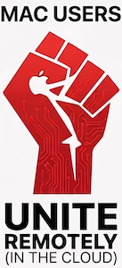
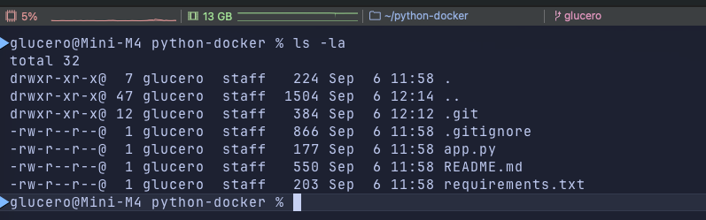
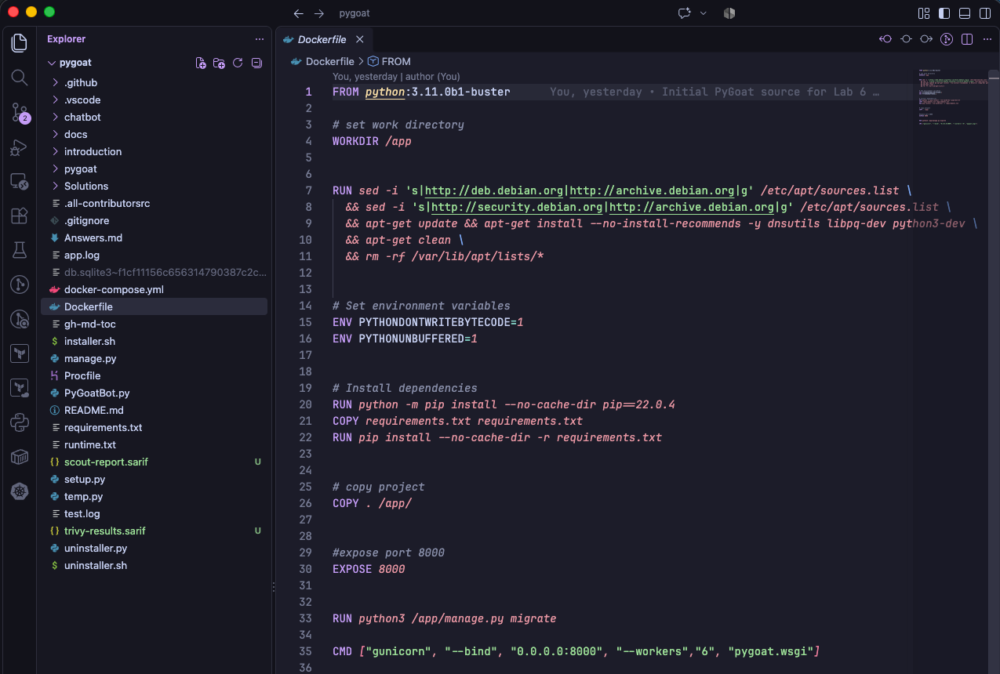

# Mac Survival Guide

*Cloud computing from the land of ⌘.*



A student-maintained collection of macOS-specific setup notes, tools, tips, and fixes for **students learning cloud computing**.

This guide began in **MIS 547: Fundamentals of Cloud Computing at the University of Arizona**. The goal isn't to reinvent your course setup. It's to document the little differences we Mac users encounter along the way and make life easier for the next person.

> **Your course instructions always win.** If anything here conflicts with a lab or instructor guidance, follow your course materials. Please [open an issue](../../issues) so the guide can be updated.
>
> This is an independent student resource, not an official University of Arizona guide.

**Jump to:** [Part 1: iTerm2](#part-1-level-up-your-mac-terminal) · [Part 2: VS Code](#part-2-level-up-vs-code) · [Contributing](#contributing)

## 🖥️ Part 1: Level Up Your Mac Terminal

A lot of cloud computing happens in the terminal. macOS already includes the Terminal app, so you **do not need iTerm2** for your course.

That said, learning cloud computing encouraged me to set up my Mac with my preferred **iTerm2** app. I find it a nicer environment when spending a lot of time working with SSH, Docker, Git, DigitalOcean, and other command-line tools.

### iTerm2 (also check out Warp and Ghostty)

[iTerm2](https://iterm2.com/) is a popular Terminal replacement for Mac with more customization, profiles, split panes, better window management, and lots of quality-of-life features. You absolutely don't need any of these for class. They're simply options if you want a better or more personalized command-line environment.

Other options worth exploring: [Warp](https://www.warp.dev/) and [Ghostty](https://ghostty.org/).

### ✨ My Setup: iTerm2

Here's the setup I've been using. Again, none of this is necessary for a cloud computing course, but it's an example of how much you can customize your terminal once you move beyond the defaults.

**Look & feel**

- JetBrainsMono Nerd Font Mono
- Catppuccin Mocha
- Increased line spacing and internal padding
- Subtle transparency and background blur
- Context-aware blinking box cursor

**A few of my favorite functional tweaks**

- 📊 **Status bar:** CPU, RAM, Git status, and current directory at a glance
- ⌨️ **Natural Text Editing:** familiar macOS shortcuts for moving and editing text
- 🧭 **Shell Integration:** visual command markers, previous-command navigation, and completion notifications
- 📜 **20,000-line scrollback:** because eventually you'll need the output that disappeared 200 commands ago
- 🪟 **160 × 50 default window:** works particularly well on a large display and splits cleanly into two 80-column panes

### 📸 What it looks like



*Note the top bar showing processor and memory utilization, current directory, and Git status. Blue triangles mark successful command prompts.*

### 🔧 Want to recreate it?

Here are the main settings behind my setup. Think of these as a starting point, not a recipe. Pick what looks useful, skip what doesn't, and make it your own!

#### 🎨 Look & Feel

- **Font:** JetBrainsMono Nerd Font Mono · 14–15 pt · 110–115% line spacing
- **Theme:** [Catppuccin Mocha](https://github.com/catppuccin/iterm) · slightly increased minimum contrast
- **Padding:** 12 px side / 10 px vertical padding · subtle transparency and blur
- **Cursor:** blinking box · context-aware cursor color

#### 🪟 Window Setup

- 160 columns × 50 rows
- Target screen: **Screen with Cursor**
- The 160-column width splits nicely into two 80-column terminal panes on a larger display.

#### 📊 Status Bar

Positioned at the top with **CPU Usage · RAM Usage · Git Status · Current Directory**.

This is one of my favorite additions. It turns the top of the terminal into a small dashboard for what's happening on the Mac and where I'm working.

#### ⌨️ Natural Text Editing

iTerm2's **Natural Text Editing** key preset gives the command line more familiar Mac editing behavior, including:

| Shortcut | Action |
| --- | --- |
| Option + ← / → | Jump by word |
| Cmd + ← / → | Jump to beginning/end of line |
| Option + Backspace | Delete a word |
| Cmd + Backspace | Clear toward the beginning of the line |

*Shortcut behavior may depend on your macOS, shell, and key-mapping configuration.*

#### 🧭 Shell Integration

I also installed iTerm2 Shell Integration with Zsh. This adds some particularly nice quality-of-life features:

- Visual marks for completed commands, including success/failure
- Jump between previous command prompts with **Cmd + Shift + ↑ / ↓**
- Job-completion notifications
- Better awareness of commands and directories within iTerm2

#### 📜 Scrollback

20,000-line history with preservation of output when applications using the terminal's status area close.

### 💡 Want the walkthrough?

You don't need to configure all of this manually from this list. If something here looks interesting, AI is great for walking through terminal customization interactively. Tell it you're using **macOS + iTerm2 + Zsh**, give it the feature or settings you want, and have it guide you through them one at a time.

I'd recommend changing a few things at a time rather than copying an entire configuration. You'll end up with a terminal that fits your workflow instead of mine.

---

<a id="part-2-level-up-vs-code"></a>

## 👨‍💻 Part 2: Level Up VS Code

There are a lot of editors and IDEs available on the Mac, and there's definitely no single right answer. I ended up using VS Code after seeing it referenced in my course materials and, as a Cursor user, doing a quick comparison of the options. For me, it hit a good balance: lightweight, easy to customize, and extensible enough for the Python, Docker, YAML, and Kubernetes work we were doing in MIS 547.

Just like Part 1, none of this is required for your course. It's more of a:

> “Hey, your editor can do this too.” 😎

### 🧰 A few options worth knowing about

- **[VS Code](https://code.visualstudio.com/):** Lightweight, flexible, and has a huge extension ecosystem.
- **[JetBrains IDEs](https://www.jetbrains.com/ides/):** More of a traditional full-featured IDE experience, with deep language/tool integration.
- **[Cursor](https://cursor.com/):** AI-focused editor built around a VS Code-style workflow.
- **[Zed](https://zed.dev/):** Fast, modern, and intentionally minimal.
- **[Vim / Neovim](https://neovim.io/):** Terminal-based, incredibly customizable, and a whole personality unto itself.

No IDE holy wars here. Use what works for you.

### ✨ My Setup: VS Code

I wanted VS Code to feel like a natural extension of the iTerm2 setup from Part 1, so I kept the same general look and added support for the tools we were using in class.

**Look & feel**

- JetBrainsMono Nerd Font Mono
- Catppuccin Mocha
- 14 pt editor font
- Font ligatures
- Increased line spacing
- Same general visual style as my iTerm2 setup

**A few of my favorite functional tweaks**

- 🐳 **Docker:** support for Dockerfiles and container workflows
- ☸️ **Kubernetes:** manifest and cluster tooling
- 🐍 **Python:** IntelliSense, environment detection, linting, and debugging
- 📄 **YAML:** schema validation and structural checks
- ⌨️ **`code .`:** launch the current project directly from iTerm2
- 🧹 **File hygiene:** spaces instead of tabs and automatic trailing-whitespace cleanup

### 📸 What it looks like



### 🔧 Want to recreate it?

Think of these as starting points, not a recipe. Pick what looks useful and ignore the rest.

#### 🎨 Look & Feel

- [Catppuccin for VS Code](https://marketplace.visualstudio.com/items?itemName=Catppuccin.catppuccin-vsc)
- JetBrainsMono Nerd Font Mono
- 14 pt font
- Font ligatures enabled
- Increased line spacing

#### 🧩 Extensions

- Docker
- Kubernetes
- YAML
- Python

*Check the extension publisher and permissions before installing.*

#### ⌨️ Terminal Integration

One of my favorite small workflow improvements is installing VS Code's `code` command into the Mac `PATH`. That lets you navigate to a project in iTerm2 and simply run:

```sh
code .
```

VS Code opens the current directory as the workspace. Tiny feature. Very convenient.

#### 📄 YAML & Kubernetes

My YAML setup is configured so files ending in:

```text
*.k8s.yaml
```

can automatically use Kubernetes schema validation and autocompletion.

I also use:

- 2-space indentation
- Spaces instead of hard tabs
- Automatic trailing-whitespace cleanup
- A custom YAML tag configuration to avoid false-positive errors where needed

### 💡 Want the walkthrough?

If something here looks interesting, AI is great for walking through VS Code setup interactively. Tell it you're using **macOS + VS Code**, then give it the setting, extension, or feature you want to configure and have it walk you through it one piece at a time.

I'd recommend adding things as you need them rather than installing a giant extension collection all at once.

### 🍎 The fun part

The terminal from Part 1 and VS Code now feel like the same workspace:

**iTerm2 → `code .` → VS Code**

Same font. Same theme. Same general vibe. Different tool.

That's really the point of both sections: the default tools work just fine, but if you spend enough time in them, it's pretty fun to make the environment feel like your own.

---

## Contributing

Found an outdated setting, a better Mac-specific workaround, or a tip that would help another student? Issues and pull requests are welcome! See [CONTRIBUTING.md](CONTRIBUTING.md).

## Attribution & License

Created by **Gabriel Lucero**, originally for fellow students in **University of Arizona MIS 547**. Independent student resource; not affiliated with or endorsed by the university.

The written guide is offered under the [MIT License](LICENSE). The “Mac Users Unite” graphic is included for layout review and is **not covered by the MIT License**; confirm permission or a suitable license before public redistribution. Third-party names and trademarks belong to their respective owners. Other images should only be reused when you have the necessary rights.
